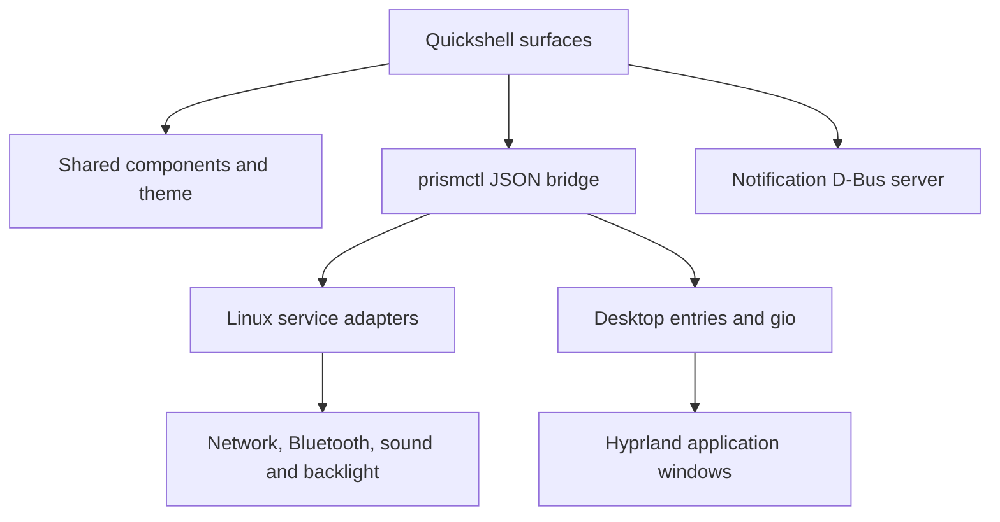

# Architecture

PrismOS keeps the new desktop independent from other projects and places all
native system writes behind one small, testable bridge.

| Location | Responsibility |
| --- | --- |
| `shell/services` | State, process dispatch, theme and notification daemon |
| `shell/components` | Tiles, sliders, pills, symbols, labels and loader |
| `shell/surfaces` | Per-monitor desktop, shade, drawer, appearance and launch splash |
| `prismos` | Python adapters, settings, color generation and desktop entry discovery |
| `design` | Original icons, wallpaper and generated shared palette tokens |
| `preview` | Offline design review; deliberately simulated hardware and applications |
| `config/hypr` | Dedicated compositor session and lock configuration |
| `packaging` | Installable Arch package and display-manager session |
| `archiso` | Overlay content, live account and package list |
| `scripts` | Preview, validation, packaging, ISO staging and GitHub publication |

## Service boundary

`prismctl` accepts explicit subcommands and returns one JSON object or array.
Nonzero exits include `{ "ok": false, "error": "…" }`. The QML dispatcher
serializes writes and coalesces queued slider commands. Controls display hardware
availability and refresh after a write; they do not invent a successful state.

External commands are argument arrays. Desktop launch uses GLib's `gio launch`
against an entry selected from XDG application directories. Desktop `Exec`
strings are never evaluated by a shell. User overrides, Hidden/NoDisplay,
OnlyShowIn/NotShowIn and TryExec are honored.

Settings use a private XDG config directory, file locking and atomic replacement.
The theme generates semantic color roles; components do not choose palette-specific
text colors. HSL tones are an initial adapter and can be replaced with HCT later.

## Runtime and performance

The initial read path polls every five seconds and collects independent hardware
queries concurrently. Command deadlines bound failures. No browser engine runs
inside the native shell and no privileged HTTP control server is exposed.

The next service pass should subscribe to NetworkManager/BlueZ/PipeWire events
and compositor toplevel changes. The shell controls its own panel animations;
Hyprland layer animations are disabled in the dedicated session to avoid double
animation. Window-open animation remains compositor-owned.

The shell creates one surface set per monitor. Panel exclusive zones reserve the
top bar and dock space. Modal focus and hotplug behavior still need qualification
on a running compositor.

## Distribution assembly

The package installs the shell/assets/config to `/usr/share/prismos`, the Python
module to `/usr/lib/prismos`, and three executables to `/usr/bin`. Session config
is copied on first launch into `~/.config/prismos/hypr` without replacing a user's
ordinary Hyprland config.

ISO staging starts from the complete installed Arch releng profile, then adds the
package through a local repository and overlays only live-specific configuration.
Official Arch package signature verification stays intact. The local development
package repository is unsigned; signed distribution packages are an M3 gate.
