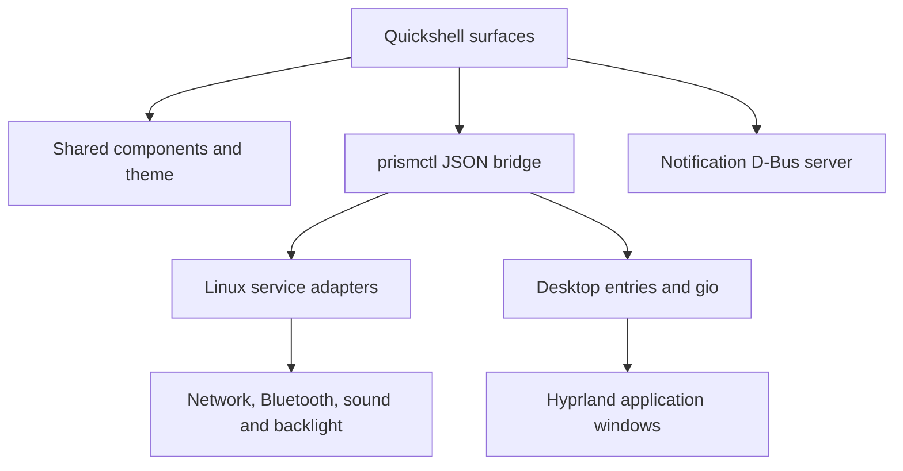

# Architecture

PrismOS keeps the new desktop independent from other projects and places all
native system writes behind one small, testable bridge.

| Location | Responsibility |
| --- | --- |
| `shell/services` | State, process dispatch, theme and notification daemon |
| `shell/components` | Tiles, sliders, pills, symbols, labels and loader |
| `shell/surfaces` | Per-monitor desktop, shade, drawer, appearance and launch splash |
| `prismos` | Python adapters, settings, color generation and desktop entry discovery |
| `design` | Original icons, wallpaper and generated shared palette tokens |
| `preview` | Offline design review; deliberately simulated hardware and applications |
| `config/hypr` | Dedicated compositor session and lock configuration |
| `packaging` | Installable Arch package and display-manager session |
| `archiso` | Overlay content, live account and package list |
| `scripts` | Preview, validation, packaging, ISO staging and GitHub publication |

## Service boundary

`prismctl` accepts explicit subcommands and returns one JSON object or array.
Nonzero exits include `{ "ok": false, "error": "…" }`. The QML dispatcher
serializes writes and coalesces queued slider commands. Controls display hardware
availability and refresh after a write; they do not invent a successful state.

External commands are argument arrays. Desktop launch uses GLib's `gio launch`
against an entry selected from XDG application directories. Desktop `Exec`
strings are never evaluated by a shell. User overrides, Hidden/NoDisplay,
OnlyShowIn/NotShowIn and TryExec are honored.

Settings use a private XDG config directory, file locking and atomic replacement.
The theme generates semantic color roles; components do not choose palette-specific
text colors. HSL tones are an initial adapter and can be replaced with HCT later.

## Runtime and performance

The status read path collects independent hardware queries concurrently, reacts
to debounced `nmcli monitor` events and retains a five-second recovery poll.
Wireless lists load when opened and refresh at eight-second intervals while
visible, pausing during an expanded Wi-Fi row. Scans and commands have bounded
deadlines. No browser engine runs inside the native shell and no privileged HTTP
control server is exposed.

PipeWire monitoring frames JSON arrays across reads and filters for audio
endpoints and default metadata. It ignores client/port churn, including objects
created by the shell's queries. Updates are debounced; failed monitors retry at
30 seconds and visible sound panels have five-second recovery polling. Sound
refresh is deferred during a drag. BlueZ subscriptions remain future work.

The shell listens to Hyprland
open/focus events and matches desktop IDs/StartupWMClass to finish a launch splash;
an eight-second deadline covers unmatched/background apps. The shell controls
its panel animations; Hyprland layer animations are disabled in the dedicated
session. Actual window-surface geometry and opening remain compositor-owned.

Wi-Fi credentials travel through QProcess stdin as one bounded JSON line, then
through a private temporary file consumed by `nmcli connection up passwd-file`.
No secret is an argv value or PrismOS preference. New profiles are private to the
current user, have autoconnect disabled during activation, and are removed if
activation fails. Existing profiles are reused by SSID and security type and are
never deleted by a failed attempt. Network selections and paired Bluetooth device
addresses are rediscovered before actions. Blueman handles new-device pairing.

Sound discovery uses `pw-dump` JSON and reads the selected endpoints with `wpctl`.
Picker writes resolve the supplied lifetime serial and node name against a fresh
graph, then run fixed `wpctl set-default`, `set-volume` or `set-mute` commands.
Volume is limited to 100%; mute is explicit. No device IDs are stored in PrismOS
preferences. WirePlumber owns default-device persistence and routing policy;
per-app stream migration is outside this slice.

Audio references: [pw-dump](https://docs.pipewire.org/page_man_pw-dump_1.html),
[WirePlumber wpctl](https://pipewire.pages.freedesktop.org/wireplumber/man/wpctl.html),
[PipeWire object keys](https://docs.pipewire.org/group__pw__keys.html), and
[WirePlumber profiles](https://pipewire.pages.freedesktop.org/wireplumber/daemon/configuration/components_and_profiles.html).

Adapter references: [NetworkManager nmcli](https://networkmanager.pages.freedesktop.org/NetworkManager/NetworkManager/nmcli.html),
[BlueZ bluetoothctl](https://github.com/bluez/bluez/blob/master/doc/bluetoothctl.rst),
[Hyprland events](https://wiki.hypr.land/IPC/), and
[Quickshell HyprlandEvent](https://quickshell.org/docs/v0.3.1/types/Quickshell.Hyprland/HyprlandEvent/).

The shell creates one surface set per monitor. Panel exclusive zones reserve the
top bar and dock space. Modal focus and hotplug behavior still need qualification
on a running compositor.

## Distribution assembly

The package installs the shell/assets/config to `/usr/share/prismos`, the Python
module to `/usr/lib/prismos`, and three executables to `/usr/bin`. Session config
is copied on first launch into `~/.config/prismos/hypr` without replacing a user's
ordinary Hyprland config.

ISO staging starts from the complete installed Arch releng profile, then adds the
package through a local repository and overlays only live-specific configuration.
Official Arch package signature verification stays intact. The local development
package repository is unsigned; signed distribution packages are an M3 gate.
